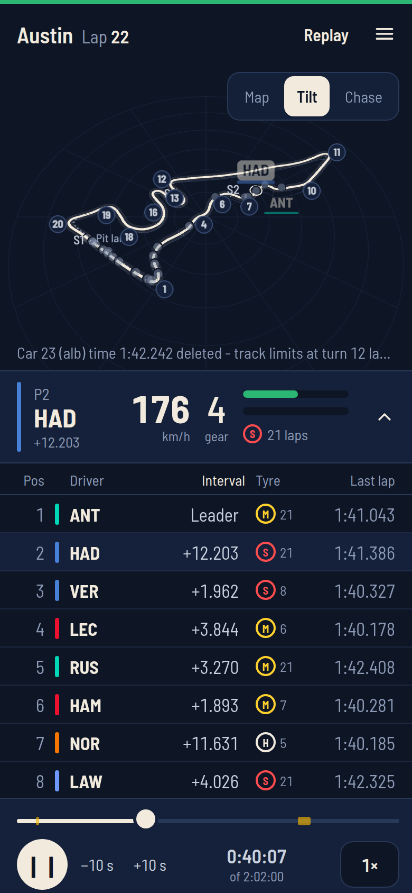
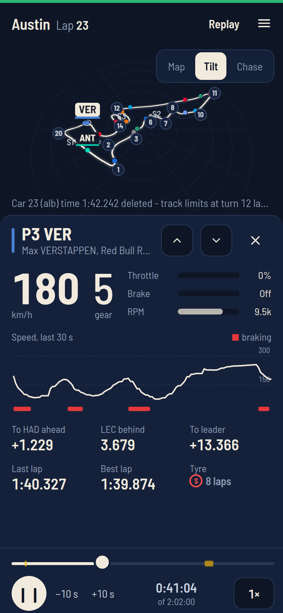
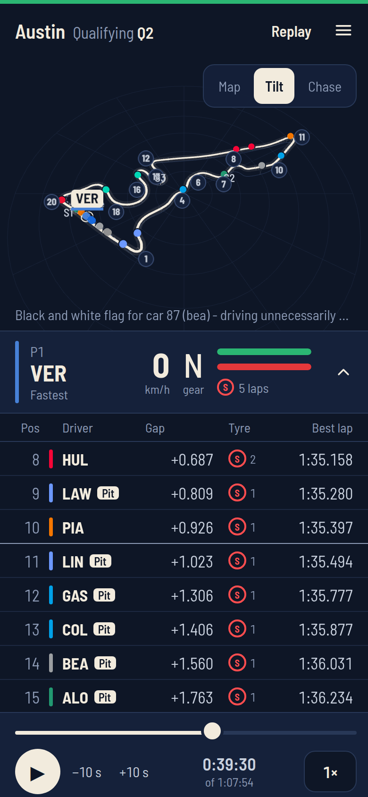
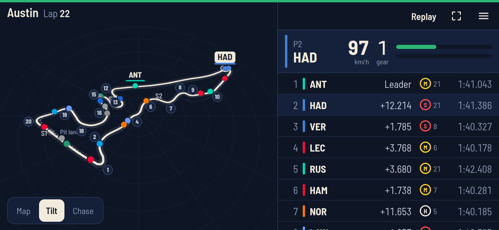

# Lapline

**A second screen for race weekends, built for the phone in your hand.**

Lapline puts the whole circuit in 3D on your phone, with every car moving on it,
a live timing tower underneath, and telemetry for whichever car you tap. Watch
a session live alongside the broadcast, or replay any past one and scrub
through it.

<p align="center">
  
  &nbsp;
  
  &nbsp;
  
</p>

<p align="center"><sub>The Austin race, 25 October 2026: the live view, telemetry for one car, and Q2 in qualifying.</sub></p>

## What it does

- **The circuit in 3D.** Every car on track at four updates a second, with
  turn numbers, sector boundaries and the pit lane drawn in. Switch between a
  flat map, a tilted view and a camera that chases the car you've picked.
- **A timing tower that fits the session.** In a race: interval, tyre and last
  lap, with purple and green for fastest and personal-best laps. In practice
  and qualifying: best lap and the gap to the fastest, timed from the
  qualifying segment that counts, with the drop zone marked and knocked-out
  drivers set apart.
- **Telemetry for one car.** Speed, gear, throttle, brake and RPM, a 30-second
  speed trace with the braking zones, and the gaps to the cars ahead and
  behind.
- **Race control as it happens.** Flags, safety cars, red flags and deleted
  laps, in the header and on the track.
- **Live or replay.** Live runs a few seconds behind the feed, and the delay
  can be nudged to line up with your broadcast. A replay plays any past
  session at up to 16×, with safety cars and red flags marked on the scrubber.
- **Portrait, landscape and glance.** Turn the phone and the track moves
  beside the tower. Glance mode shows the top five in large type, for a phone
  propped up across the room.

<p align="center">
  
</p>

## How it works

```
   OpenF1 (REST, and MQTT live)
              │
   ┌──────────▼───────────┐
   │  Server (Node)       │   one upstream feed, shared by every viewer;
   │  fetch · derive ·    │   works out flags, tyres, gaps, sectors and
   │  circuit · stream    │   the pit lane from the raw rows
   └──────────┬───────────┘
              │  server-sent events, 4 frames a second
   ┌──────────▼───────────┐
   │  Phone (React,       │   the scene draws itself in three.js;
   │  three.js, Zustand)  │   React handles the panels around it
   └──────────────────────┘
```

All the data comes from [OpenF1](https://openf1.org). The browser never calls
it: one server holds the credentials, spends the rate limit once however many
phones are watching, and streams compact frames to each of them, about 8 kB a
second. The circuit is not drawn from a stored map. Its outline, corners,
sectors and pit lane are derived from where the cars actually drive.

It runs as a single service on [Railway](https://railway.com), behind a
password, at [lapline.live](https://lapline.live).

## Running it

You need Node 22.12 or later.

```
npm install
npm run dev
```

`npm run dev` starts a mock of the OpenF1 API, the server and the web app
together, with the app at http://localhost:5173. The mock drives a made-up
circuit with a race that runs live and a sprint to replay. The first screen
says live data is locked, because live sessions need an OpenF1 sponsor
account; tap **Replay sprint instead** and the cars start moving.

To watch real past races instead, which OpenF1 serves free, point it at the
real API and pick a session in Settings:

```
OPENF1_BASE= npm run dev
```

[`docs/FORKING.md`](docs/FORKING.md) has more ways to run it, and how to deploy
your own copy.

```
npm test             # unit tests (Vitest)
npm run typecheck
npm run build
npm start            # the production server, serving the built app
```

There are also checks that drive a real browser at phone size against the
running app: `layout` measures the screen against the design, `scene` checks
the 3D view, `states` walks every race state, `stale` kills the server and
watches the screen recover, `rotate` turns the phone mid-session, `circuits`
tries the track pipeline on real circuits, and `soak` watches a long run from
outside. Run any of them with `npm run <name>`. They drive Chrome; without
it, run `npx playwright install chromium` once and set `PLAYWRIGHT_CHANNEL=`
(empty) to use Playwright's own browser.

Every setting is an environment variable, and all are optional. They are listed
under "Configuration" in [`docs/ARCHITECTURE.md`](docs/ARCHITECTURE.md#configuration).

## Where things are

```
apps/server/        the Node service: openf1/ client, feed/ session and clock,
                    derive/ calculations, circuit/ track detail, http/ SSE
apps/web/           the phone app: React UI around an imperative three.js scene
packages/shared/    the protocol between them, as zod schemas
tools/mock-openf1/  a stand-in for OpenF1 for development
tools/              the browser checks above
design/             artboards, the visual source of truth
docs/               architecture, design spec, build plan, OpenF1 notes
```

- [`docs/FORKING.md`](docs/FORKING.md): running your own copy, and where to
  change how it looks or what it works out.
- [`docs/ARCHITECTURE.md`](docs/ARCHITECTURE.md): how it's built, why, every
  setting, and what has been measured.
- [`docs/DESIGN.md`](docs/DESIGN.md): tokens, layout, track drawing and every
  state.
- [`docs/OPENF1.md`](docs/OPENF1.md): how the data source behaves, quirks
  included.
- [`docs/BUILD-PLAN.md`](docs/BUILD-PLAN.md) and [`docs/HISTORY.md`](docs/HISTORY.md):
  the milestones it was built in, and what they found.
- [`AGENTS.md`](AGENTS.md) and [`CLAUDE.md`](CLAUDE.md): the working rules,
  written for coding agents, and what is still open.

## Status

All ten milestones are done. The last check was the Austin race on
25 October 2026: watched start to finish on a phone without touching it, at a
steady 60 frames a second, with the server's memory steady at about 150 MB.
Still open: a long soak run against the real feed rather than the mock.
`AGENTS.md` lists the rest.

## About

A personal, non-commercial project. Lapline is unofficial and not affiliated
with Formula 1. F1 and related marks are trademarks of Formula One Licensing
B.V. Timing and position data come from OpenF1, which is likewise unofficial.

The code is under the [MIT licence](LICENSE), so fork it and make it your own.
The data it shows is not: OpenF1's data is licensed for non-commercial use, and
that applies to any copy you run. [NOTICE.md](NOTICE.md) has the details,
including the font and the circuit files.
